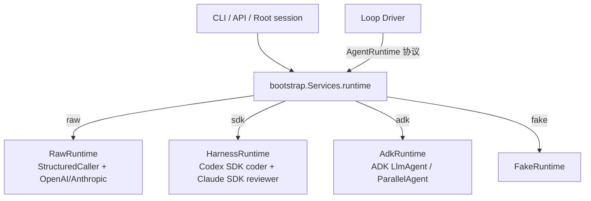
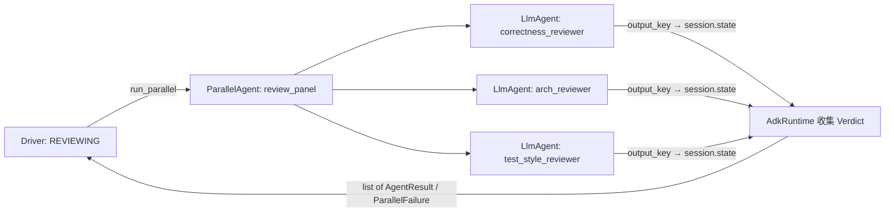

# ADK Runtime 设计方案（Route C）

> 状态：P1、P2 已实现；P3（`ParallelAgent` 评审团）待实现。对应 DISCOVERY.md §二 / ADR-001 中「Google ADK 作为 Agent 执行层」以及 §16 中 `AdkRuntime` 占位项。

## 1. 目标与边界

在现有自研 multi-agent 之外，新增一条 **用 Google ADK 执行 agent 分工** 的路线，用户通过 `--runtime adk`（或 `AGENTLAB_RUNTIME=adk`）切换。

一句话原则：**Driver 决定「谁、什么时候、做什么」，ADK 只负责「这个 agent 怎么做完」。**

| 由谁负责 | 内容 |
|---|---|
| 自研 Loop Driver（不改） | 状态机、收敛 / 震荡判定、Arbiter、Gate、人工审批、checkpoint 与断点续跑、revision 绑定 |
| 自研 core（复用） | 角色 → alias 路由与 fallback、重试分类、预算预留 / 熔断、usage 记账、attempt 记录、工具授权与审批 |
| ADK（新增） | 单个角色的 agent 执行（模型调用 + 工具循环）、评审团并行（`ParallelAgent`）、生命周期 callbacks |

**不做**：不用 ADK 的 `SequentialAgent` / `LoopAgent` 替代 Driver 的主流程。主流程交给 ADK 会出现两套状态机，ADK 的 session 状态也没有 Driver 那样的 checkpoint、revision 绑定和 `WAITING_HUMAN` 语义，断点续跑和审批会失效。DISCOVERY.md §十一已经把这一点列为风险。

## 2. 三条 Runtime 路线的位置



三条路线实现的是同一个 `core/ports.py::AgentRuntime` 协议（`run_agent` / `run_parallel`），Driver 对此无感知。这是本方案保持架构清晰的关键：**ADK 相关代码全部落在 `adapters/runtime/adk/` 下，core 和 driver 不 import ADK。**

## 3. 模块结构

把现有单文件占位 `adapters/runtime/adk.py` 改为一个包：

```
src/agentlab/adapters/runtime/adk/
├── __init__.py     # AdkRuntime / AdkCaller：实现 AgentRuntime 协议，唯一对外入口；最终输出校验与 repair
├── agents.py       # 角色 → LlmAgent 的构建（prompt、工具）
├── model.py        # AgentLabLlm(BaseLlm)：把 ADK 的模型调用接到现有 gateway + 重试 + 记账
└── tools.py        # 把 ctx.tool_factory(role) 的工具适配为 ADK BaseTool
```

依赖方向（只允许向下）：

```
adk/__init__.py ──▶ agents.py, model.py, tools.py
        │                              │
        └──────────────▶ agentlab.core（routing / retry / budget / monitor / schemas）
```

## 4. 各模块设计

### 4.1 `AdkRuntime`（`__init__.py`）

```python
class AdkCaller(StructuredCaller):
    # 继承：工具授权解析、Router alias 链、RetriesExhausted 换 alias、AgentResult 组装、ctx.on_result
    # 只重写 _call_alias：在一个 alias 上构建 LlmAgent → Runner.run_async，
    # 取最终文本校验 output_type，失败则在同一 session 追加 repair 消息

class AdkRuntime:
    def __init__(self, cfg: AppConfig, chat: ChatFn) -> None: ...

    async def run_agent(self, role, inp, output_type, ctx) -> AgentResult[T]:
        return await self._caller.call(role, inp, output_type, ctx)

    async def run_parallel(self, inputs, output_type, ctx) -> list[AgentResult[T]]:
        # 用 ParallelAgent(sub_agents=[每个 reviewer 一个 LlmAgent]) 跑评审团
        # 部分失败时抛 ParallelFailure(cause, 已完成的 results)，保持 Driver 的部分结果复用
```

- 构造参数与 `RawRuntime` 对齐：bootstrap 把同一个 `chat`（OpenAI 兼容 + 可选 Anthropic）传进来，ADK 路线和 raw 路线共用 gateway 凭证与 `models.yaml`，不需要新的模型配置。
- 每次调用用一个临时的 `InMemorySessionService` session。ADK session 只是一次调用内的草稿纸，持久状态仍然只在 `Store` 里。

### 4.2 角色构建（`agents.py`）

从现有配置直接生成，不新增 YAML：

| ADK 字段 | 来源 |
|---|---|
| `name` | 角色名（`coder`、`arch-reviewer` …，`-` 替换为 `_`） |
| `instruction` | `cfg.prompt(role)`（已被 Driver 冻结到 `frozen_prompts`），以 instruction provider 传入，绕开 ADK 的 `{state}` 模板替换（prompt 里有 JSON 花括号）。ADK 会在末尾追加一行 `You are an agent. Your internal name is "<role>".` |
| `model` | `AgentLabLlm(alias)` |
| `tools` | `tools.adapt(ctx.tool_factory(role))`，授权仍由 `config/agents/*.yaml` 的 `tool_grants` 决定 |
| 用户消息 | `render_user_message(inp)`，与 raw 路线完全相同 |

reviewer 的 `kind: reviewer` 决定它们进入 `run_parallel`；这一点由 Driver 决定，`agents.py` 不做判断。

### 4.3 模型适配（`model.py`）—— 方案的核心

写一个 `AgentLabLlm(BaseLlm)`，ADK 每次需要调模型时都经过它：

```
ADK LlmAgent ──▶ AgentLabLlm.generate_content_async(llm_request)
                   ├─ 预算：ctx.reserve_budget(estimate)   / finally release_budget
                   ├─ 记录：ctx.attempt_started(...)        / attempt_finished(...)
                   ├─ 调用：call_with_retry(chat(...))       复用 Retryable / NonRetryable 分类
                   ├─ 记账：commit_usage(ctx, usage.for_call(role, alias, model, attempt_id, ...))
                   └─ 返回：LlmResponse（文本或 function_call）
```

为什么不直接用 ADK 自带的 `LiteLlm`：

- 重试、预算熔断、usage 记账、attempt 记录都是确定性逻辑，现在已在 `core/llm/` 里稳定运行，并且 Monitor、断点恢复都依赖这些记录。用 `LiteLlm` 意味着在 ADK callback 里重写一遍，而 callback 无法表达「这次调用失败后重试」。
- 包一层 `BaseLlm` 后，raw 和 adk 两条路线的计费与失败语义一致，Monitor 和 eval 结果可以直接对比。

`temperature`、`max_output_tokens` 和输出 schema 由 `AgentLabLlm` 按 route / alias 直接传给 gateway，与 raw 路线一致；工具列表取 `ctx.tool_specs`（与注册给 ADK 的工具是同一组）。

ADK 的 `types.Content` 装不下两样东西：模型原始的工具参数文本（参数不是合法 JSON 时 raw 路线会把原文交给工具执行器报错），以及 Anthropic 带签名的 thinking 块（工具调用轮必须原样回放）。它们按工具调用 id 存在单次调用的 `CallState` 里，回放时再还原。

`core/llm/attempt.py` 提供两个共享原语：`metered_call`（单次模型调用 + 重试 + 预算 + 记账）和 `invoke_tool`（单次工具调用 + 记录 + 错误映射 + 结果截断）。raw 路线的 `StructuredCaller` 与 ADK 路线共同调用它们，这是本方案对 core 的全部改动，属于纯重构，raw 路线行为不变。

### 4.4 工具适配（`tools.py`）

```python
class GrantedTool(BaseTool):      # 每个 tool spec 一个实例
    name, description, parameters  ← 来自 ctx.tool_factory(role) 返回的 spec
    async def run_async(args, tool_context):
        ctx.check_budget(0)
        ctx.record_tool({... "status": "started"})
        value = await execute(name, args)      # 现有执行器：白名单、审批、编辑日志都在里面
        ctx.record_tool({... "status": "completed"})
        return value
```

- 工具的授权、危险操作审批、`workspace_write` 的编辑日志都在现有 `execute` 里，适配层只做格式转换，不另做权限判断。
- ADK 的 function response 必须是对象；非对象结果包在私有键 `_agentlab_value` 下，`AgentLabLlm` 回放前解包，模型看到的内容与 raw 路线逐字节一致。
- 外部 MCP 工具已经由 Driver 的 `hooks.external_tools` 合并进 `tool_factory`，所以第一版不使用 ADK 的 `MCPToolset`，避免同一个 MCP server 出现两条接入路径。

### 4.5 结构化输出

不使用 ADK 的 `output_schema`。schema 与 raw 路线一样经 gateway 的 `schema` 参数下发（JSON 模式 + system 中的 schema 说明），`AgentLabLlm` 声明 `output_schema_and_tools=False`。最终文本由 `output_type.model_validate_json` 校验；失败时在同一 session 追加一轮 repair 消息，次数复用 `retry.structured_output_repair.max_repairs`。这样有工具和无工具的角色走同一条路径。

### 4.6 评审团并行（ADK 的 multi-agent 分工）



- 每个 reviewer 设置 `output_key=<role>`，`AdkRuntime` 从 session state 读取各自输出并分别校验。
- 每个 reviewer 使用自己的 alias（`model_policy.yaml` 中三个 reviewer 本来就分配了不同模型），体现「异构评审」。
- 单个 reviewer 失败不能连带取消其他 reviewer：每个子 agent 外包一层错误捕获（把异常写入 state 而不是向上抛），最后统一组装 `ParallelFailure(first_error, completed_results)`。这样 Driver 现有的「部分 reviewer 结果复用」逻辑不用改。
- alias fallback 在 reviewer 层面按角色独立进行：失败的 reviewer 用下一个 alias 单独重跑，不重跑已成功的 reviewer。

## 5. 接入点改动

| 文件 | 改动 |
|---|---|
| `adapters/runtime/adk.py` | 删除，替换为 `adapters/runtime/adk/` 包 |
| `core/llm/structured.py` | 改为调用 `core/llm/attempt.py` 的 `metered_call` / `invoke_tool`，行为不变 |
| `bootstrap.py::runtime` | `adk` 分支改为 `AdkRuntime(cfg, raw.chat)`，与 raw 共用 chat；未安装 ADK 时抛 `AdkUnavailable`（`MissingGatewayConfig` 子类，API 返回 400） |
| `pyproject.toml` | `adk = ["google-adk==2.11.0"]`，与 harness extra 一样锁定精确版本 |
| `.github/workflows/checks.yml` | Python 任务 `uv sync --frozen --extra adk`，ADK 测试在 CI 中实际运行 |
| `docs/DISCOVERY.md` | 实现完成后更新 §16 状态表与 ADR |

Driver、Arbiter、Gate、Store、API、UI 都不需要改动。Root session 和 summarizer 也通过 `svc.runtime()` 取 runtime，因此选择 `adk` 时它们同样走 ADK，无需额外分支。

## 6. 恢复与幂等

- ADK session 不持久化；恢复完全依赖现有机制：Driver 的 checkpoint + `attempt` 记录（`AgentLabLlm` 照常写入），中断后的 reviewer 会通过 `recovered_response` 复用已完成结果。
- 一次 `run_agent` 中途中断时整次调用重跑，这与 raw 路线现在的语义相同；写入类工具的幂等由现有编辑日志（`edit_journal`）保证。

## 7. 测试与验收

| 层级 | 内容 |
|---|---|
| 单元 | 用假的 `chat` 驱动 `AgentLabLlm`：重试分类、预算预留与释放、usage 记账、attempt 记录与 raw 路线逐字段一致 |
| 单元 | `tools.py`：工具调用经过 `execute`，`record_tool` 的 started/completed 事件齐全；未授权工具不可见 |
| 单元 | `run_parallel`：一个 reviewer 失败时其余结果保留，抛出 `ParallelFailure` |
| 契约 | `tests/unit/test_adk_runtime.py`：同一组 gateway 回复分别喂给 raw 与 ADK，比较 gateway 收到的每次请求、工具执行、usage、attempt 与最终 `AgentResult` |
| 端到端 | `tests/unit/test_acceptance_cross_provider.py` 的 Driver 场景按 `raw` / `adk` 参数化：跨厂商交接、Claude 故障回退 GPT、缺少凭证暂停 |
| 离线 eval | `evals/baseline.json` 分别用 `--runtime raw` 与 `--runtime adk` 跑，对比成功率与成本 |
| live（可选） | `tests/live/` 增加一条 ADK 真实网关冒烟测试，默认跳过 |

未安装 `google-adk` 时，选择 `adk` 必须给出明确错误（沿用现有 `AdkUnavailable`），不能静默回退到 raw。

## 8. 分阶段落地

1. **P1 抽公共调用**：从 `StructuredCaller` 抽出 `metered_call`，raw 路线全部测试保持通过。
2. **P2 单角色**：`AgentLabLlm` + `agents.py` + `tools.py` + `output.py`，`run_agent` 跑通 planner / coder / summarizer / root。
3. **P3 评审团**：`run_parallel` 改用 `ParallelAgent`，补齐部分失败语义和契约测试。
4. **P4 文档与 eval**：README 中英文增加 runtime 说明，跑 raw vs adk 对比 eval，更新 DISCOVERY.md。
